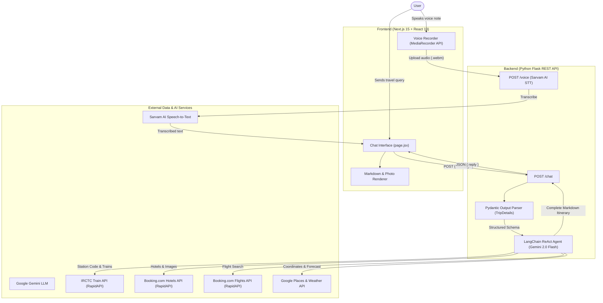

# 🌍 Trip-Mitra (Travel Mitra)

> An AI-powered, multi-modal travel assistant that generates complete, personalized holiday itineraries from natural language text or voice notes.

Trip-Mitra automates the entire travel research process. By analyzing conversational travel prompts, it extracts travel constraints, orchestrates multiple real-world data APIs (railways, flights, hotels, weather), and synthesizes a structured, day-by-day travel plan complete with accommodation photos, local transit tips, and an itemized budget breakdown.

---

## 🚀 Key Features

* **🎙️ Multi-Modal Input (Voice & Text):** Speak directly into your microphone or type your plans. Voice notes are recorded in the browser and transcribed using **Sarvam AI** (`saaras:v2.5`).
* **📐 Schema-Validated Extraction:** Uses **Pydantic** (`TripDetails`) and **LangChain** prompt templates to reliably parse origin, destination, travel dates, passenger counts, and budgets into typed schemas.
* **🤖 Multi-Tool AI Agent:** Powered by **Google Gemini 2.0 Flash** in a ReAct framework, dynamically selecting and querying external travel APIs.
* **🚆 Live Train Schedules:** Resolves Indian railway station codes and retrieves outbound and return trains with timings and class availability via the **IRCTC API**.
* **✈️ Flight Comparison:** Automatically evaluates round-trip flight alternatives and pricing via **Booking.com Flights API** for journeys where budget permits.
* **🏨 Hotel Recommendations with Photos:** Queries **Booking.com Hotels API** to find top-rated accommodations within budget, calculating taxes and embedding direct photo previews.
* **☀️ Weather-Aware Daily Itinerary:** Uses **Google Places** and **Google Weather APIs** to retrieve multi-day forecasts (temperatures, rain probability, sunrise/sunset) and tailors daily schedules accordingly.
* **📊 Itemized Budget & Packing List:** Generates categorized packing checklists and compares estimated expenses (transport, stay, food, activities) against the user's target budget.

---

## 🏗️ System Architecture



---

## 📂 Project Structure

```text
trip-mitra/
├── src/                          # Next.js 15 Frontend
│   ├── app/                      # App router pages
│   │   ├── chat/page.jsx         # Chat page interface
│   │   ├── globals.css           # Tailwind styles & theme variables
│   │   ├── layout.js             # Root layout & font configuration
│   │   └── page.jsx              # Landing page
│   ├── components/               # React UI components
│   │   ├── ChatInput.js          # Text input & microphone voice recorder
│   │   ├── ChatWindow.js         # Conversation thread & auto-scrolling
│   │   ├── MessageBubble.js      # ReactMarkdown renderer with image cards
│   │   └── NavBar.jsx            # Responsive navigation bar
│   └── lib/
│       └── api.js                # Frontend API client
│
├── backend/                      # Python Flask Backend
│   ├── services/                 # External service & agent integrations
│   │   ├── flight_service.py     # Booking.com flights search & IATA resolver
│   │   ├── gemini_agent.py       # LangChain ReAct agent & tool definitions
│   │   ├── hotel_service.py      # Booking.com hotels search & photo parser
│   │   ├── train_service.py      # IRCTC train schedules & station code resolver
│   │   └── weather_service.py    # Google Places geocoding & Weather API
│   ├── app.py                    # Flask server, Pydantic parser & routes
│   └── requirements.txt          # Python dependencies
│
├── .env.local                    # Frontend environment configuration
├── package.json                  # Next.js dependencies
└── README.md
```

---

## 🛠️ Tech Stack

| Domain | Technology | Purpose |
| :--- | :--- | :--- |
| **Frontend Framework** | **Next.js 15** (App Router) + **React 19** | Modern server/client rendering and routing |
| **Styling** | **Tailwind CSS v4** | Utility-first responsive design |
| **Markdown & Media** | `react-markdown` + `remark-gfm` | Formats itineraries and renders hotel photo previews |
| **Backend API** | **Flask** + **Flask-CORS** | Python REST API serving chat and voice endpoints |
| **Data Validation** | **Pydantic** | Schema validation and strict type casting for query parameters |
| **AI Orchestration** | **LangChain** | ReAct agent framework and tool execution pipelines |
| **Primary LLM** | **Google Gemini 2.0 Flash** | Query reasoning, entity extraction, and itinerary generation |
| **Speech-to-Text** | **Sarvam AI (`saaras:v2.5`)** | Multi-lingual audio transcription |
| **External APIs** | **RapidAPI** (IRCTC, Booking.com), **Google APIs** | Real-world train, flight, accommodation, and weather data |

---

## ⚙️ Getting Started

### 1. Prerequisites
* **Node.js** v18+ (tested on v22)
* **Python** 3.11 or 3.12

### 2. Frontend Setup
```bash
# In the project root
npm install

# Start the development server
npm run dev
```
The frontend will start at `http://localhost:3000`.

### 3. Backend Setup
```bash
# Navigate to backend directory
cd backend

# Create and activate a virtual environment
python -m venv .venv
# On Windows:
.\.venv\Scripts\activate
# On macOS/Linux:
source .venv/bin/activate

# Install dependencies
pip install -r requirements.txt sarvamai pytz

# Start the Flask API
python app.py
```
The backend server will run on `http://localhost:5000`.

---

## 🔑 Environment Variables

### Backend (`backend/.env`)
Create a `.env` file in the `backend/` directory with the following keys:
```env
GOOGLE_API_KEY=your_google_api_key          # Gemini LLM, Google Places & Weather
STT_API_KEY=your_sarvam_api_key             # Sarvam AI speech-to-text
HOTELS_API_KEY=your_rapidapi_booking_key    # Booking.com Hotels API (RapidAPI)
Flight_API_KEY=your_rapidapi_flight_key     # Booking.com Flights API (RapidAPI)
IRCTC_API_KEY=your_rapidapi_irctc_key       # IRCTC Trains API (RapidAPI)
```

### Frontend (`.env.local`)
Create a `.env.local` file in the project root:
```env
NEXT_PUBLIC_BACKEND_URL=http://localhost:5000
```

---

## 💡 Example Prompt & Output

**User prompt:**
> *"Plan a 4-day trip from Delhi to Varanasi for 2 adults with a budget of ₹25,000 starting next Monday."*

**Generated Itinerary Sections:**
1. **Trip Overview:** Travel dates, traveler summary, and budget constraints.
2. **Transportation:** Recommended outbound & return trains with train numbers, departure/arrival timings, and duration.
3. **Accommodation:** Top 3 vetted hotels matching budget with review scores, distance to landmarks, and embedded images.
4. **Day-wise Itinerary:** Morning, afternoon, and evening activities with localized weather forecasts and transit recommendations.
5. **Practical Packing Checklist:** Grouped by Clothing, Toiletries, Electronics, and Medicines.
6. **Estimated Cost Breakdown:** Detailed itemized budget (tickets, hotel, local cabs, food, buffer) compared against user's budget.
